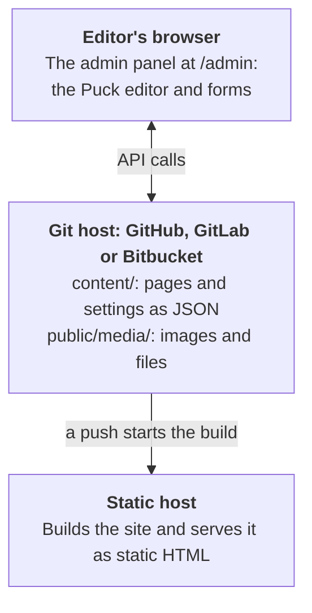

<h1>
  <picture>
    <source media="(prefers-color-scheme: dark)" srcset="docs/public/media/logo-dark.svg">
    
  </picture>
</h1>

A git-based website builder built on the [Puck](https://puckeditor.com) visual editor.

Goodfellow gives non-technical site owners a drag-and-drop editor at `/admin` with no server, database or monthly hosting bill. Pages are stored as files in the site's own GitHub, GitLab or Bitbucket repository. Every save is a commit, and a free static host (GitHub Pages, GitLab Pages, Cloudflare Pages or Vercel) rebuilds the site. It started with small organizations run by volunteers, and is built to suit larger ones too, where a marketing team runs the content and developers own the code, its blocks and its reviews.

> **Status: early development.** The packages are on npm, released together with one version number, and the [roadmap](#roadmap) shows what's done and what's next. The [documentation](https://goodfellow-cms.github.io/goodfellow-cms/), built with Goodfellow, describes the latest release: what Goodfellow does, how to [create a site](https://goodfellow-cms.github.io/goodfellow-cms/docs/create-a-site), and how to write blocks. [The demo](https://goodfellow-cms.github.io/goodfellow-demo/admin/) lets anyone try the admin panel.

## How it works

- **No server.** The admin panel is part of the static site and talks to the GitHub, GitLab or Bitbucket API straight from the browser. Next.js apps with a server of their own can have it [publish for editors](https://goodfellow-cms.github.io/goodfellow-cms/docs/full-stack-nextjs) instead.
- **Instant preview.** The editor renders pages in the browser, so editors see changes before anything is published.
- **Publishing is a commit.** A commit to the main branch triggers the host's normal build. The admin panel shows when the new version is live.
- **Content is plain files.** One JSON file per page, readable in any diff and portable to other tools.

## Roadmap

1. **Static rendering** (done). Build a static site from hand-written `content/` files.
2. **Editor** (done). The admin panel against local files: pages, site settings, header and footer, custom CSS, live Tailwind preview.
3. **Git backends** (done). GitHub and GitLab sign-in, publishing, conflict detection and deploy status, plus GitHub Pages, GitLab Pages and Vercel setups.
4. **Collections and templates** (done). Collections with their own fields, a shared page design for their items, and a block that lists them on other pages.
5. **AI assistant** (done). Draft and rewrite pages with Claude, OpenAI or a free AI service, called straight from the editor's browser with the editor's own key. Editors without a key can copy a prompt into Claude.ai or another chat app and paste the answer back.
6. **Media library** (done). Upload, browse and replace images and files from the admin panel, and choose them for blocks and settings. A Video block plays uploaded videos, YouTube and Vimeo videos, and other sites' players, without adding JavaScript to the site's pages.
7. **Starters** (done). `create-goodfellow`, which creates a site and sets up its storage and host, and an example parish site with collections and custom blocks.
8. **Next.js adapter** (done). Goodfellow pages and the admin panel in a Next.js app, exported as static files, with a Next.js starter. Links use `next/link` and images `next/image`, sites can be served from a subfolder, and blocks can use Client Components.
9. **Interactive blocks everywhere** (done). Client Components in blocks (`"use client"`) run in the browser on sites built with `goodfellow build` too, not only with Next.js.
10. **shadcn blocks** (done). A registry of Goodfellow blocks built with [shadcn/ui](https://ui.shadcn.com), installed into the site without a developer. When creating a site, admins choose "Recommended" or "Built-in blocks only"; the admin panel lets them add and remove individual blocks. Others can publish registries of blocks built with other libraries, in a documented format. Updating installed blocks comes with step 16's automatic updates.
11. **Demo mode** (done). A site whose config sets `demo: true` (it can only be turned on in the config, never from the admin panel) opens its admin panel to anyone, with no sign-in. Visitors can try everything, from editing pages and collections to the media library, settings and the AI assistant, but nothing is published: their changes stay in their own browser until they start over. The demo starts from a copy of the site's content that the build includes, so the repository can stay private.
12. **Documentation site** (done). A documentation site built with Goodfellow itself, in `docs/`, and the blocks it needs, which any site can use: code with syntax highlighting, search (with [Pagefind](https://pagefind.app), indexed only on sites that use a search block), navigation within a collection, previous and next links, and an "On this page" list. Collections can store their items as Markdown files, edited in the admin panel's formatted editor or as Markdown. The docs cover why Goodfellow exists and how it compares with alternatives such as WordPress and TinaCMS, guides for site owners and editors, reference docs for developers, and each host's rules for business sites on its free plan. Online at [goodfellow-cms.github.io/goodfellow-cms](https://goodfellow-cms.github.io/goodfellow-cms/) since step 13.
13. **Going live** (done). Make the repository public, publish the packages to npm, and put the documentation site online with GitHub Pages. A demo site, made from the parish example in a repository of its own with the published packages, goes online with GitHub Pages too, and the docs link to it.
14. **Site setup without a developer** (done). The documentation site's [Create a site](https://goodfellow-cms.github.io/goodfellow-cms/new-site/) page creates a site from any starter, with the same choices as `create-goodfellow`, in the person's own GitHub or GitLab account, straight from their browser, and puts it online with GitHub Pages, GitLab Pages or Vercel. It asks what the site is for and recommends a host whose free plan allows it, such as GitLab Pages for a business, and warns that GitHub Pages doesn't work with private repositories on GitHub's free plan. On GitHub, people sign in with a token the page links to, or with GitHub where the page has step 21's sign-in service; on GitLab, with GitLab or a token. The page writes the repository into the site's config, so nobody has to edit it.
15. **Custom domains** (done). Connect a domain from the admin panel's **Site Settings → Domain**. Goodfellow connects it on GitHub Pages or GitLab Pages, lists the records to add at the domain's registrar, with guides for popular registrars in the docs, and checks until the domain works: the records, as the world sees them, the host's HTTPS certificate, and the site at its new address. Then it sends everyone to the secure address. Sites on Vercel connect their domain in Vercel, as the screen explains.
16. **Running a site without a developer.**
    - Invite and remove editors from the admin panel (done).
    - Version history, with a way to restore an earlier version of a page (done).
    - Automatic updates (done): a scheduled job updates Goodfellow, and blocks added from block registries, and publishes the update only if the site still builds. Block updates replace only files nobody has changed. Fixes install on their own; newer releases when an owner chooses them. Owners can turn automatic fixes off, or go back to the previous release, which is then skipped.
    - Plain-language explanations when a rebuild fails (done).
    - Redirects from old addresses, set up in Site Settings and added when a page moves, which work on every host (done).
17. **Calendars** (done). An Events collection and a Calendar block, worked out when the site builds, so visitors only get HTML.
    - **Events** have a start and end date and time, an all-day option, a place, and repeats (daily, weekly, monthly or yearly, every so often, on chosen weekdays or the same weekday of the month, until a date, with dates to skip), so a weekly service is one entry. Collections get a date-and-time field for them, which any collection can be a calendar of, and Site Settings a time zone. New collections can start as Events.
    - **The Calendar block** shows upcoming events as a list or a month at a time, with a page for each month. The nightly rebuilds keep "upcoming" current.
    - **Calendars kept elsewhere:** the block can also show a public calendar feed (an `.ics` address, such as Google Calendar's), read when the site builds, so editors who keep a Google Calendar go on doing so and the site catches up on its next build.
    - **Subscribing:** the build writes the events as an `.ics` file that visitors can subscribe to, and each event has "Add to calendar" links.
    - **The docs** also describe embedding a Google Calendar in a Custom HTML block (with its sanitizing turned off, since that removes embedded frames), following Google's guide, [Add a calendar to your website](https://support.google.com/calendar/answer/41207). The calendar is then managed in Google, and changes show up at once rather than after the next rebuild, though it looks like Google's calendar rather than the site.
18. **Showing collections** (done). Blocks that show a collection's items anywhere on the site, such as a blog page with every post or a home page section with the three latest news articles or the next five events, worked out when the site builds, so visitors only get HTML.
    - **Collection list** filters by a choice field or by tags (a new field type for several choices), has a heading and a "See all" link, and more ways to sort.
    - **Pages of items:** a long list is split into pages of its own (`/blog/page/2`), with links between them, and a list can have a page for each of a field's choices (`/blog/topics/events`). Any block can ask for pages like these, as the Calendar block does for its months. Each page has its own address for search engines, and only the first is in the site's own search.
    - **Collection loop:** a block whose contents, designed in the editor with any blocks, repeat once for each item, with the item's fields filled in as in a collection's page design, for layouts the list's own styles don't cover.
    - Visitors don't sort or filter lists themselves: editors choose each list's order and filters, and the Search block finds the rest.
19. **Forms** (done). A Form block whose questions (wording, kind of answer, whether it must be answered, choices and help text) are set in the editor.
    - **No server:** it's a plain HTML form that posts to a form service and works without JavaScript; the service emails the answers and sends visitors back to a thank-you page the editor chooses. The service is chosen once in Site Settings: [Web3Forms](https://web3forms.com) by default (250 answers a month free, and no account, just an email address), [Formspree](https://formspree.io) (whose free plan shows its own thank-you page), or any service that accepts a plain form post.
    - **Spam:** a hidden honeypot field on every form, plus the service's own captcha: Formspree's reCAPTCHA, or Web3Forms' hCaptcha, which a Site setting turns on, since it needs Web3Forms' script on pages with a form.
    - **Longer forms**, such as surveys and sign-up sheets, can use Google Forms: the Form block shows one from its embed code.
    - **The docs** explain that answers go to the chosen service, not to the site's repository.
20. **Stock photos from the AI assistant** (done). When the media library has nothing that fits, the AI assistant can add openly licensed photos from [Openverse](https://openverse.org), which gathers Creative Commons and public domain images from Wikimedia Commons, Flickr and other collections. It's searched straight from the editor's browser with no key, and only photos whose license allows commercial use and changes are offered. Each photo is saved to the media library with its credit, which the site shows as the license requires. A checkbox in the AI panel turns this on or off for each request and is remembered in the browser; a site's config can turn it off for everyone. (Not Unsplash: its API needs a key that a browser can't keep secret, and its rules require showing photos from Unsplash's own addresses rather than the site's media library.)
21. **Sign in with GitHub** (done). A small Cloudflare Worker that a site's owner, or an organization for all its sites, can run, so editors sign in with GitHub instead of pasting a token. Goodfellow may run one for every site in the future; until then, sites without one sign in with tokens. GitLab sign-in already works without one.
    - **Narrow tokens:** site owners install a Goodfellow GitHub App on the repositories they choose, which the first sign-in offers, and GitHub's install page signs them in too. The worker gives the admin panel a token for one repository only, with only the permissions it needs (not workflows or repository settings), lasting an hour and renewed while the editor is signed in. It stores nothing: the editor's own GitHub token is revoked as soon as they've signed in, and commits still show the editor as their author.
    - **Only to the site's own address:** the worker hands a token only to an address the repository's site settings list, never to `localhost`, since `goodfellow dev` and `next dev` don't need one.
    - **Within Cloudflare's free plan:** the worker keeps no counts of its own, since every request it gets counts towards the plan's daily limit, even one it turns away. When the day's requests run out, editors sign in with a token until the next day, and a Cloudflare rate limiting rule, on a domain of its own, can stop any one computer using them up.
    - **Token sign-in stays:** when the admin panel can't use the worker, for example because its limit for the day has been reached or a production build is being viewed on `localhost`, editors sign in with a token as they do now.
    - **Protected history:** the site setup page (step 14) can sign in through the worker too, and gives new repositories rules that stop anyone rewriting the main branch's history, where the GitHub plan allows it. GitLab protects it by default.
    - **Owner tools:** a second Goodfellow GitHub App, with the Administration and Pages permissions, used only by owners on the Editors and Domain screens, replaces the owner token. The everyday sign-in's app never gets those permissions, so editors' tokens can't delete the repository or change its settings.
    - **Setting it up:** `pnpm run setup` deploys the worker and creates its two GitHub Apps, and the site's config names its address.
22. **Claude connector** (done). An MCP server, so editors can work on their sites from Claude: read pages, items and settings, see the site's blocks, make changes in a draft, check them in screenshots, and publish them or submit them for review.
    - **Ways to use it:** a Claude Desktop extension (a `.mcpb` file) and `claude mcp add` for Claude Code, running on the editor's computer with a token; or a connector service on Cloudflare Workers, which an organization runs with `pnpm run setup`, as for the sign-in service, and editors add as a custom connector in Claude on the web, on computers and on phones, and in Claude Code. Goodfellow may run one for everyone in the future.
    - **Drafts:** changes go into a draft, a branch of the site's repository, and publishing applies it to the main branch in one commit, stopping rather than overwriting anyone else's changes. Submitting for review opens a pull request or merge request.
    - **Versions:** each site's build publishes a description of its blocks and of the content formats it reads (`goodfellow-site.json`), so Claude writes only content that site understands. It works with the current and previous minor versions of Goodfellow, and asks older sites to update.
    - **Nothing stored:** the connector signs in to GitHub through its own GitHub App, separate from step 21's, and gets a token for one repository for each of Claude's requests, which it revokes once the request is answered. Who connected and which sites they chose are sealed inside Claude's own tokens; the only thing stored is a number for each connection, so a refresh token works once. GitLab, which has no tokens for one project, uses the editor's own GitLab sign-in, sealed the same way.
    - **Within Cloudflare's free plan:** the tools read only the files they need, in batches, to fit the free plan's limits on each request, and Cloudflare's own limits and rate limiting rules apply, as for the sign-in service.
    - **Screenshots** of the live site, and of drafts through a preview page in each site's admin panel, taken with Cloudflare's Browser Rendering, or with the editor's own Chrome or Edge on their computer.
23. **Light and dark sites** (done). A site can have a dark mode, which its owner turns on in Site Settings: sites are light only until then. Every theme color has a dark one, and pages follow the visitor's light or dark setting. Blocks follow the theme in both, a site can have a second logo for dark backgrounds, code changes to dark colors with the page, in code colors the site chooses, visitors can choose light or dark with the Dark mode switch block, and the admin panel's previews show either.
24. **Full-stack Next.js sites** (done). For organizations with a developer: Goodfellow as the CMS of a Next.js app with a server of its own, beside the app's own pages. Sites without a server stay the default, and nothing here becomes required for them.
    - **Sign-in through the app:** the admin panel signs in with the app's own authentication (such as Better Auth), and the app says who may edit and publish, and who may also change settings.
    - **Git on the server:** the app's server reads and publishes through GitHub or GitLab with a token from an environment variable, behind that sign-in, so no git credentials reach the browser. Commits still name the editor.
    - **AI keys on the server** (optional): keys in environment variables, with the AI assistant's requests sent through the app's server, so editors don't need keys of their own.
25. **Content in a repository of its own** (done). A site can keep its content (`content/` and `public/media/`) in one repository and its code in another, so the tokens editors and full-stack sites' servers use can change the content but never the code that builds and runs the site.
    - **Either repository builds:** the content repository's build checks out the code without being able to change it (with a deploy key on GitHub, or the job token on GitLab) and publishes the site, so the admin panel still shows when a change is live, explains failed rebuilds and connects domains; or the code repository builds, and a change to the content starts it through the host's deploy hook. Whoever can push to the repository a host builds from controls the build, so sites whose build holds secrets, such as a full-stack site's token and keys, build from the code repository. Nightly updates run in the code repository, which then starts the build.
    - **Setup:** `create-goodfellow` and the setup page offer it, with either repository building, and create both repositories and what connects them.
    - **In the admin panel**, everything that edits content works as before. Adding and removing blocks writes code, so it becomes a developer's task, and the Updates screen follows the code repository's updates.
    - **Settings stay with the content:** Site Settings, custom CSS and code, and collections' settings stay in the content repository, since some saves change settings and content in one commit, such as removing a collection's field from every item.
    - **Developers** keep a copy of the content repository beside the code, which `goodfellow dev` and `next dev` read and save to.
26. **Site checks** (done). Catch mistakes before they're published, in the admin panel when publishing and in builds.
    - **Errors that stop publishing:** links to pages, items or media that don't exist, including ones a deletion would break, besides the checks loading the site already makes. Moving a page or an item, or changing a collection's addresses, updates every link to them instead.
    - **Warnings editors can publish anyway:** pages without a title or description, theme colors that text is hard to read on (which the Theme tab shows as colors are chosen), and, on the pages a publish changes as they'll show, images without alt text, headings that skip a level, and links whose text doesn't say where they go ("click here").
    - **In builds:** `goodfellow build` lists what the checks find, and `--strict` fails the build on errors. Built pages, Next.js sites' too, are also checked for accessibility problems with axe-core, explained in plain words. Automated checks can't show that a site is fully accessible, so Goodfellow never claims it is.
27. **Scheduled publishing** (done). Pages and collection items that appear at a date and time, and disappear after one, such as a bulletin, a Lent schedule or a closure notice.
    - Content carries its own "show from" and "hide after", which builds apply in the site's time zone, as calendars do. On GitLab, the admin panel adds a pipeline schedule for each time, so changes go live then; on GitHub, the starters check each hour and build the site only when something is due, so changes go live within the hour.
    - The admin panel lists what's coming up, and when.
    - Scheduled content is in the site's repository before it appears, so on a public repository anyone can read it there early, as the admin panel says when scheduling.
    - Later, a group of changes can be scheduled together, as a draft that's published at a set time.
28. **Search engines and feeds** (done).
    - **Structured data** (schema.org JSON-LD), so search engines show events with their dates and places, and news as articles.
    - **For each page:** hiding it from search engines, and a preview of how it looks when shared.
    - **Feeds:** RSS and Atom feeds of collections whose items are dated, such as news, which feed readers and other sites can follow.
    - **Sites in a subfolder** (done): search engines read `robots.txt` only at a domain's root, so builds of a site such as `your-name.github.io/your-site/` say how to have them find its sitemap.
    - **Fonts from the site itself** (done): builds copy the site's Google Fonts into it, so pages load them without connecting to Google, sooner and without telling Google who visits. Full-stack Next.js sites, whose pages Next.js serves as it renders them, still load them from Google.
29. **Moving from and to WordPress** (done).
    - **Importing:** a WordPress site's pages, posts, categories, tags, menus and media, from its export file or its address, in the admin panel or from the command line, with WordPress's blocks turned into Goodfellow's and old addresses kept or redirected.
    - **Exporting:** a Goodfellow site as a WordPress export file, in the admin panel or from the command line, with its blocks turned into WordPress's.
30. **Restoring the whole site** (done). Version history beyond one file: owners can see how the whole site, its content and settings, looked at an earlier publish and what has changed since, and restore it as one publish, for example after a bulk change that went wrong.
31. **Several languages** (done). Optional, for sites in more than one language, such as a parish with Masses in two.
    - Translations of a page or collection item linked together, each language's pages under its code (`/es/…`), with its own menus, header and footer, site name and description, and dates written the language's way.
    - A Language switch block, `hreflang` links, sitemaps that list each language, and search that finds pages in the page's own language.
    - Which translations are missing or out of date, in the Pages screen, the editor and the site checks, and translating a page or item with AI. Where a page has no translation, the switch goes to the language's home page, and a language's pages list only its own items.
32. **Cloudflare Pages** (done). Put sites online with [Cloudflare Pages](https://pages.cloudflare.com), whose free plan builds from private repositories on GitHub and GitLab and has no rule we've found against business sites. That makes it the free choice for a business site whose repository is private on GitHub, where GitHub Pages doesn't work.
    - **Pages, not Workers:** a subdomain can keep its DNS elsewhere on Pages but not on Workers, Pages needs no config file kept in step with Cloudflare's dashboard, and its 500 builds a month are plenty for a typical site. Cloudflare has a guide for moving to Workers later.
    - **Setup:** `create-goodfellow --host cloudflare-pages` and the setup page set it up, and the setup page recommends it for business and private sites on GitHub. Cloudflare can't build on a schedule, so the site gets a GitHub workflow or GitLab pipeline that runs the nightly update and the checks for scheduled changes, and asks Cloudflare to rebuild through the project's deploy hook, so the Updates screen and scheduled publishing work as on GitHub Pages and GitLab Pages. Sites whose content has a repository of its own build from it.
    - **Live:** the admin panel shows when the new version is live from what Cloudflare reports to GitHub (check runs, or commit statuses for tokens) and GitLab (commit statuses). The sign-in service's everyday app and token links ask for Checks and Commit statuses, read-only, and installations that haven't accepted them yet still sign in.
    - **Domains and videos:** the Domain screen explains connecting a domain in Cloudflare, as it does for Vercel, and the media library warns about uploaded videos, which Cloudflare's terms ask free plans to serve through its paid services, and suggests YouTube or Vimeo.
    - **Redirects:** `goodfellow build` and `goodfellow-next finish` write `_redirects` next to the redirect pages, which stay for other hosts, listing only the redirects they wrote pages for, since Cloudflare follows a redirect even where the site has a file. Past Cloudflare's 2,000 lines, about 1,000 old addresses at two lines each, the build says so, and the pages handle the rest.
33. **Keeping tokens away from third-party code** (done). So owners can install plugins safely (step 35), editors' tokens and builds' secrets can be kept away from any code Goodfellow didn't write.
    - **In this order,** each a pull request of its own: the editor's sandbox, for every site (done); then admin domains (done), the usual way for a site on GitLab Pages, as the setup page recommends, at a domain its owner already has; then the token broker (done), for sites on GitHub Pages and sites without a domain; then safer builds and the admin panel's own Content Security Policy (done); then the setup page, `create-goodfellow` and the docs' Security page (done).
    - **A token broker, if the site's owner wants one** (done): a small static page on an address of its own, which keeps editors' GitHub and GitLab tokens and AI keys in its own storage and makes every call to the git host and AI services itself. It shows the site's admin panel in a sandboxed frame, which asks it to read files and publish changes through messages, so nothing on the admin panel's or the site's own address can read the tokens, Goodfellow's own code included. It answers only the site whose address the repository's settings list, never changes workflow files, and asks the editor, in its own part of the page outside the admin panel's frame, before publishing code, packages or custom code. Signing in gives tokens to it rather than to the site. Sites without one keep signing in as they do now, with the admin panel keeping its own tokens where the editor chose.
    - **Run by the site's owner:** a site, or an organization for all its sites, serves the broker's files from an address of its own that hosts nothing else, deployed from a release. Goodfellow may run one for everyone in the future, deployed only from releases and with no preview copies, so it's always a released version.
    - **Adding one to an existing site** (done): Site Settings' Security tab sets the broker's address, and offers owners **Add a token broker**: with a token that can create repositories, it makes the broker's repository on the site's host from Goodfellow's released files (`@goodfellow-cms/broker`'s `site/`, from jsDelivr) and a `broker.json` naming the site, and puts it online with GitHub Pages or GitLab Pages, or leaves it ready for Cloudflare Pages or Vercel. Its address is then published in the site's config, from the same tab, once it's online, so editors sign in through it once the site has rebuilt. The address has to be the broker's alone: Cloudflare Pages and Vercel give it one, and so do GitHub Pages and GitLab Pages with a domain of its own, or GitLab Pages with its unique domain setting on, which needs no domain at all and, since `gitlab.io` is a public suffix, is a different site from the one it serves. Never a shared `github.io` or `gitlab.io` address, such as `your-name.github.io/broker` or `your-group.gitlab.io/broker`, which every Pages site in the same account or group shares. `goodfellow broker add` writes the same repository from a computer, and `goodfellow broker use` and `goodfellow broker remove` set or remove its address. `create-goodfellow` and the setup page offer an admin address (where the host allows one) or a broker for new sites, the broker on a GitLab unique domain for sites on GitLab, and removing the broker goes back to the admin panel keeping its own tokens. Making the broker's repository from the admin panel signs in with a token, since the sign-in service only sends setup sign-ins back to the setup page.
    - **An admin domain, instead of or as well as a broker** (done): the same build at a second address, such as `admin.example.com`, where editors sign in, while visitors use `example.com`. It's another origin, so the site's pages can't read the admin panel's storage, and it needs no second repository and no other account. It needs:
      - **The admin domain to be only the admin panel's:** every page starts with a script, the first thing in its `<head>`. A site page loaded from the admin domain stops loading, so nothing after the script runs, and then goes to the same page on the site's domain; the admin panel loaded anywhere but its own address goes there. Builds write the script into the HTML they output (`goodfellow build`'s rewrite and `goodfellow-next finish`), rather than leaving it to each renderer, since Next.js puts `async` scripts in `<head>` that could run before it. They then check every file a browser would open as a page (HTML, SVG and XML, `404.html` and redirect pages included), and the admin domain isn't set up while any lacks the script. Tests try every way a script after it could run first, such as `async`, `defer` and module scripts, event handler attributes and frames, in Chromium, Firefox and WebKit.
      - **Headers as well, where the host sends them:** on Cloudflare Pages and Vercel, every other page on the admin domain also gets `Content-Security-Policy: sandbox`, which runs it in an opaque origin without the admin panel's storage, so a page served there can't read tokens even when a site page frames it. Tried first in Chromium: a pasted script on a site page served from the admin domain read the token without the header and was refused with it. Cloudflare Pages does this with a `_headers` rule for the admin domain and `! Content-Security-Policy` under `/admin/*`; Vercel with `headers` that match the host, or `redirects` that send those pages to the site.
      - **The admin panel to start only at its own address,** named in `goodfellow.config.tsx`, not content, since sign-in gives tokens to it; elsewhere, such as `example.com/admin/`, it sends people there. The sign-in worker gives tokens to that address as well as the Site address, reading it from `goodfellow-site.json`, which builds write from the config.
      - **Headers on the admin panel,** where the host sends them: `Cross-Origin-Opener-Policy: same-origin`, `frame-ancestors 'none'`, and `Origin-Agent-Cluster: ?1`, since the two addresses are the same site though they're different origins. Without them, on GitLab Pages, the admin panel refuses to draw itself in a frame and checks where every message it gets comes from, and a browser may run the two addresses in one process, which a broker on an address of its own, a different site, avoids.
      - **Setting it up:** the Domain screen connects the second domain, so a backend's `pages` can have more than one, with a capability flag for hosts that serve one (GitHub Pages), and writes the host's rules. The admin panel counts the admin domain only once it has checked it, by loading a site page from its own address and finding the script first in it, and sandboxed or redirected where the host sends headers.
      - **Where it works:** GitLab Pages, Cloudflare Pages and Vercel. Not GitHub Pages, which serves one domain, and its `www`, for each site; sites there use a broker.
      - **With content in a repository of its own** (done): the config is the code's, which editors' sign-in can't change, so the Domain screen connects the domain and a developer names and checks it with `goodfellow admin add` and `goodfellow admin check`, which reads the site's pages at the address from a computer as the admin panel does from there. Where Vercel builds from the content repository, the address's header rules are written out in its `vercel.ts`, which Vercel reads before the code is cloned.
      - **Cloudflare in front of GitLab Pages:** for a site on GitLab Pages whose domain's DNS is already on Cloudflare, the docs give the redirect and response header rules Cloudflare's free plan has, which match the admin domain and add the headers above. They work only with Cloudflare's proxy on, which the docs now say to turn off for GitLab Pages, so they're documented once they've been tried on a real domain.
    - **Without a broker or an admin domain, nothing third-party is installed from the admin panel:** the tokens there are within reach of the site's own pages, so the Blocks screen offers only Goodfellow's own registry (done), and plugins (step 35) can't be installed there. Developers can still add either in code. Themes can be installed on any site, since a theme is only CSS and JSON files, which the admin panel checks before writing them; a theme with any other file is refused.
    - **The editor in a sandbox of its own** (done), with or without a broker: Puck, the site's config and every block run in a frame sandboxed without `allow-same-origin`, whose code can reach nothing. It has no storage, can't open windows or reach the admin panel's page, and its Content Security Policy lets it fetch nothing and run only the site's own scripts. It can still show pictures, styles and players from other sites, and a sandboxed page can always leave for another address, so the policy limits what blocks can send rather than sealing it: the sandbox is what keeps tokens out of their reach. Every one of those scripts starts by removing WebRTC, which a Content Security Policy can't block. It talks to the admin panel through one message port, and the admin panel draws Publish outside it, so nothing in the editor can publish on its own.
      - **Previews:** Puck draws blocks straight into the editor's page (`iframe: { enabled: false }`), since a sandboxed page can't reach frames of its own. The editor's copy of the site's CSS is kept to the canvas, each rule's selectors under it, so it can't restyle Puck, and its width media queries become container queries, so Goodfellow's own buttons preview pages at phone and tablet widths by resizing the canvas.
      - **The rest of the admin panel** keeps out of reach the same way: the site's code never runs in the admin panel's own page. The Settings and Version history previews, the pages rendered to check a publish, and the preview page for screenshots are the same kind of frame, and the AI panel moves out of the editor into the admin panel, with the keys in the broker where there is one.
      - **Tried first:** Puck 0.23 edited, dragged blocks and published this way in Chromium, the starter's CSS stayed on the canvas, and a block's requests, storage and WebRTC were all refused. The tests run in Chromium; Firefox and Safari still need the same checks.
    - **What a broker or an admin domain closes:** the admin panel shares its address with the site it edits, and on `github.io` and `gitlab.io` addresses with every other site in the same account or group, so without either, scripts on those pages could read a token kept with "Stay signed in".
    - **Pages that open the admin panel can't reach it** (done): the broker sends `Cross-Origin-Opener-Policy: same-origin` and `frame-ancestors 'none'`, the admin panel opens links with `noopener`, and its own Content Security Policy keeps its frames on the editor's pages. The site's other pages get no Content Security Policy, so code admins paste in, such as analytics, keeps working without a list of the addresses it uses: those pages hold no tokens to protect.
    - **Safer builds** (done): on GitHub, the starters' builds hold no secrets and can't publish. Each job gets only the permissions it needs: the jobs that run the site's code can only read the repository and keep no credentials in it, the job that puts it online doesn't run the site's code, and the nightly update builds the site with a token that can only read before a separate job, which runs none of its code, publishes the update (`goodfellow update --commit`). Packages' install scripts run only where they're allowed: the starters' `.npmrc` turns them off, since none of their packages need one. On GitLab, every job in a project gets the same token, so once updates are turned on, any job can publish.
    - **Full-stack sites don't use the broker:** their admin panel signs in with the app's own sign-in and their server holds the token (step 24), so it would add nothing. The editor's sandbox still keeps blocks' code away from the app's API. Securing the rest, the app's server, sign-in, pages and secrets, is their developers' responsibility.
    - **A Security page in the docs** (done) says what keeps a Goodfellow site safe, in general terms for owners and editors and in detail for developers: what each protection guards against and where it stops, and what a token broker or an admin domain adds. It says which protections don't cover full-stack sites, and that securing those is their developers' responsibility. It links to the pages that go further, such as running your own sign-in service and broker, Content in a repository of its own and Full-stack Next.js sites, and to how to report a security problem privately. Why Goodfellow links to it.
34. **Fewer builds.** Free plans count build minutes (GitLab's 400 a month, shared by every project in a group) and builds (Cloudflare Pages' 500 a month), so sites build only when visitors would see something new, and editors decide when.
    - **Builds that replace each other** (done): GitLab Pages jobs are `interruptible`, so a publish made while the site is building cancels that build and builds both, as GitHub's concurrency group already lets one waiting run stand for several publishes. A build cancelled or replaced that way isn't a failure: where the branch has moved on, the backends report the newer build, which includes it.
    - **Nightly builds only when something changed** (done): every build writes `goodfellow-build.json` beside the site with the commit and Goodfellow version it was built from, and when it stops being current: the next time anything the site shows by today's date changes, such as an event's next date, a calendar's upcoming events or its month pages, which each place that reads today's date reports (`changesOn()`), or a scheduled change. A site showing another calendar's feed is current for a day at most, since a feed's changes can't be known ahead. Each night, a command that checks first (`goodfellow nightly`) builds the site only when an update the site's settings allow is available, the repository has changed since the live site was built, or the time it stops being current has passed. On GitHub, the hourly check for scheduled changes also builds the site the first hour after that time. A GitLab Pages job can't end without publishing, so there the check publishes the live site's files again, from the last pages job's artifacts, which needs no more than a pages job can do already, rather than starting the build in a pipeline of its own. Sites whose content is kept in a repository of its own, and sites on Vercel, still build every night; giving their setups the check is left to do.
    - **A switch for the nightly build** (done): the Updates screen lets owners choose when the site rebuilds overnight: only when something changed (the default), every night, or never, which warns that dates go stale and fixes aren't installed. On GitLab it turns the nightly pipeline schedule on or off, and gives it `GOODFELLOW_NIGHTLY` for every night; on GitHub, the workflow's jobs read a repository variable (`GOODFELLOW_NIGHTLY`) in their conditions, so a night that's off uses no minutes, and the owners' app asks for the Variables permission to set it.
    - **Rebuild now** (done): owners can rebuild the site from the admin panel without publishing a change, for a site whose nightly build is off, or whenever the live site should catch up, such as with another calendar's feed. On GitHub it starts the deploy workflow, with the owners' sign-in, which can start workflows; on GitLab it starts a pipeline on the main branch with `GOODFELLOW_REBUILD` set, which the setup files read as a build without an update. Sites on Cloudflare Pages rebuild through their deploy hook, from the same workflow or pipeline. The admin panel follows the rebuild as it follows a publish's.
    - **Several pages in one publish** (done): the editors' Publish button also offers **Add to draft**, which keeps the change on a draft branch (step 22's `branchDrafts()`), which the starters never build. The admin panel shows the draft on every screen, with **Publish all**, which runs the publish checks over every file in it, then publishes it in one commit, with one rebuild, and fails like any publish where someone else has changed the same files since. A draft stays when the tab closes, other editors see it, one started from Claude can be finished in the admin panel, and **Submit for review** opens a pull or merge request for it. Cloudflare Pages and Vercel build a preview of every branch unless told not to, so the starters' `vercel.ts` turns previews of drafts off, and the setup steps for Cloudflare Pages and the Next.js starter on Vercel do. Backends without drafts (full-stack sites, demo mode and the development servers) keep the draft in the browser instead, and AGENTS.md's Draft now means any unpublished changes kept this way, not only Claude's.
35. **Plugins and themes.**
    - **In this order,** each a pull request of its own: blocks' named parts and the theme's classes for them (done); then themes as packages, installed and updated from the admin panel (done); then the plugin format, with its permissions enforced where they can be, for developers to add in code (done); then installing plugins from the admin panel (done); then S3 storage, the first plugin, in a repository of its own (done).
    - **Plugins** add what blocks can't: screens and code in the admin panel, steps in the build, and routes on full-stack sites' servers (done), tasks that run in the site's CI with secrets the admin panel never holds, and where media is stored, which S3 storage added to the format (done). Anyone can publish one in a documented format, as with block registries, listed with its publisher's npm provenance and installed at an exact version.
    - **Each in a repository of its own,** Goodfellow's own included, so plugins are released on their own schedules and under their own licenses, and declare the Goodfellow versions they work with (a `peerDependencies` range on `@goodfellow-cms/core`), which the admin panel checks before installing one or updating Goodfellow. None live in this repository.
    - **Named so they're easy to find,** as NodeBB's are: repositories and npm packages are called `goodfellow-plugin-<name>` and `goodfellow-theme-<name>`, or `@scope/goodfellow-plugin-<name>` on npm, and carry the `goodfellow-plugin` or `goodfellow-theme` topic on GitHub and GitLab and keyword on npm, so searching any of them finds them. The admin panel lists only packages named this way. Block registries follow the same convention, which they already can: their repositories are called `goodfellow-blocks-<name>`, with the `goodfellow-blocks` topic.
    - **Permissions that are enforced where they can be:** a plugin declares what it needs, and each part runs where Goodfellow can hold it to that.
      - **Blocks in the editor** run in step 33's sandboxed editor, where they can do nothing on their own (done).
      - **What a plugin needs in the admin panel**, such as requests to its own service, runs in a sandboxed frame for that plugin, whose Content Security Policy the admin panel writes from its declared permissions, so it reaches only the addresses it declared. Its blocks ask it by message, and other plugins' code in the editor could ask it too, but only for what it offers, never its access itself (done).
      - **Screens in the admin panel** run in frames of their own the same way, which the admin panel's page answers only for what the plugin declared, such as reading media or writing `content/media.json`, refusing every read and publish outside the files it declared (done).
      - **Build steps** each run in a process of their own, with only the secrets they declared and Node's permission model limiting which files they read and write, in a job that can't publish (done).
      - **What can't be enforced is said plainly:** code on the site's pages runs with everything visitors' browsers allow, since pages have no Content Security Policy (step 33), and a plugin's code runs with everything its process has, with the packages it brings sharing it. So the admin panel calls declared permissions what they are wherever only a review can back them.
    - **Installed by owners** (done) from the admin panel, on sites with a token broker or an admin domain (step 33), which shows what each plugin asks to do and what its packages' code does (network requests, shell commands, `eval`, install scripts), with the editor confirming in the token broker, or with an admin domain, in the admin panel outside the editor's sandbox. New releases are installed only once they're a few days old, since most harmful releases are found by then. The site's own workflow then writes the lockfile with `npm install --package-lock-only --ignore-scripts`, which runs none of the new code, and the site rebuilds with it. Like blocks, plugins are only ever included when the site builds. On full-stack sites, whose builds and servers hold the server's secrets, installing one is submitted for review, for a developer to accept. Developers can still add them in code, on any site, and `create-goodfellow` for new sites (all done). Still to come: choosing plugins on the setup page, and installing them on Vercel, which builds sites itself, so its sites need a workflow that writes the lockfile.
    - **S3 storage**, the first plugin ([`goodfellow-plugin-s3`](https://github.com/goodfellow-cms/goodfellow-plugin-s3), done): media in any S3-compatible service (Amazon S3, Cloudflare R2, Backblaze B2, DigitalOcean Spaces, MinIO and others) in place of `public/media/`, with much larger files allowed, such as long videos, since nothing goes into the repository's history. Content still refers to media as `/media/…`, so pages don't change when a site's media moves, and the Media screen moves the site's existing media to the bucket and back. The access keys stay in GitHub's or GitLab's CI secrets, never in the admin panel or the browser: each batch of uploads is signed by a task in the site's CI, which takes about a minute, and goes straight from the browser to the bucket. Full-stack sites can do the same, or keep the keys on their server, which signs uploads straight away. Still to come: tasks for sites whose content is in a repository of its own.
      - **Static sites:** the access keys stay in GitHub's or GitLab's CI secrets, never in the admin panel or the browser. Uploads go through the site's CI, which holds the keys, so they take about a minute.
      - **Full-stack sites** can do the same, or keep the keys on their server, which signs uploads straight away.
    - **Themes:** a site's look as data, with no code, so owners can install one without anyone else's code running: its colors, fonts and other design tokens, the classes it gives blocks' named parts, optional CSS, and optionally a header and footer design. Published, named (`goodfellow-theme-<name>`) and listed like plugins, each in a repository of its own. Goodfellow's own is [Harbor](https://github.com/goodfellow-cms/goodfellow-theme-harbor).
      - **Named parts** (done): every block marks its parts with stable names, such as `gf-code` or `gf-card-title`, which are part of Goodfellow's documented format and never renamed, like blocks' props. A theme gives each part classes, which come after the block's own and before what an editor types, so `my-6 rounded-lg` in a block, `my-4 rounded-xl` from the theme and `my-8 mx-4` from an editor give `rounded-xl my-8 mx-4`. Blocks from registries can name their parts too.
      - **Installing** (done), on any site, copies the theme's CSS and JSON files into the site's content, where owners change it like any setting, with a record of where it came from, so an update to the theme keeps what they changed. Where its CSS loads anything but Google Fonts and the site's own media, the admin panel lists what before installing it. Like plugins, a release is offered once it's a few days old and only on the Goodfellow releases its `peerDependencies` range names, with its npm provenance shown, and the Updates screen says when a newer Goodfellow release is outside the installed theme's range.
36. **Bitbucket** (done). Sites stored on Bitbucket Cloud, as a third backend, `@goodfellow-cms/bitbucket`, with everything GitHub and GitLab have, or a capability flag the admin panel handles where Bitbucket can't do something.
    - **First, what works from a browser** (done): Bitbucket's API answers browsers' requests; editors sign in with a repository access token, an Atlassian API token, or Bitbucket's own sign-in, which without a server lasts two hours at a time; and a publish of several files is one commit, which Bitbucket refuses when someone else has published since.
    - **Putting sites online** (done): with Bitbucket Pipelines on Vercel, since Bitbucket's own static websites have one address for each workspace and no custom domains, and Cloudflare Pages doesn't build from Bitbucket yet. `create-goodfellow --bitbucket` creates sites there too. The setup page doesn't offer Bitbucket, since it's for people who aren't developers, who rarely use it; developers who keep their code on Bitbucket can run `create-goodfellow`.
    - **Same as the others** (done): version history, editors (people already in the workspace), drafts and reviews (pull requests), failed rebuilds explained, nightly updates and scheduled publishing through Pipelines' schedules, plugins' tasks, and a fake of Bitbucket's API for the tests, as GitHub and GitLab have. Scheduled changes go live at their time, as on GitLab: each gets a schedule of its own that only asks Vercel to rebuild, which takes seconds of the free plan's 50 build minutes a month.
    - **Content in a repository of its own and the Claude connector service** (done), as on GitHub and GitLab: Vercel builds the site from either repository, and the connector signs editors in with a Bitbucket OAuth consumer.
37. **Gutenberg as an editor.** A plugin (step 35) that lets editors edit pages in WordPress's block editor, Gutenberg, in place of Puck, for people who already know it.
    - **First, WordPress's own blocks** (done): built-in blocks for WordPress's core blocks Goodfellow had nothing like, where they're plain HTML that needs no script or server, so the plugin can offer what WordPress does, Puck's editors get them too, and moving from and to WordPress keeps them as they are rather than flattening them: Separator, Pullquote, Preformatted, Verse, Details, File, Audio, Media & text, Gallery, Page list and Table, with a grid of cells to edit it in; Section gets Cover's overlay, minimum height and focal point, and Site name and logo can show the site's tagline. WordPress's other blocks (social icons, embeds from other services, a gallery's lightbox) stay out of scope.
    - **Nothing changes outside the editor:** content stays in Goodfellow's files as it is, so the plugin can be added to or removed from any site, and each editor can choose Puck or Gutenberg for themselves, remembered in their browser.
    - **A plugin that replaces the editor** (done): step 35 gets a kind of plugin, `editor`, whose module draws the page editor in a sandboxed frame like the editor in step 33. It's given the page's data, the site's description (its blocks' fields, `describeSite()`), the language, the media chooser and the link preview, hands back the page's data and never sees a token; the admin panel checks what comes back against the blocks' fields before publishing (`checkEditedData()`). Each person chooses Puck or a plugin's editor in the editor's header, and the AI assistant, Undo and Redo work with either. This is Goodfellow's own (MIT) and is tested with a small editor plugin of the tests' own, before Gutenberg is involved.
    - **A prototype first** (done, in `goodfellow-plugin-gutenberg`): Gutenberg places a block's inner blocks in one place, so blocks with several slots, such as Columns and Section, need a way to place each slot inside the block's own layout, and the canvas needs to show blocks without the site's code (see the license below): from the render frame's HTML, or from their fields alone. Both work:
        - **Slots:** each slot is a locked inner block of its own. It draws its blocks with a React portal into the empty `<gf-slot>` the block's HTML leaves in its place, with `display: contents`, so Columns' items sit side by side and every block stays Gutenberg's to select and edit.
        - **Drawing blocks:** the render frame drawing one block at a time with Goodfellow's renderer looks like the site. Drawing from fields alone always works but loses the layout, so it's the fallback while the frame loads or where it can't draw a block.
        - **What the plugin needs from Goodfellow** (done): an editor plugin's `session.draw(block)` has the site's own code draw one block in the page edited, with each slot left as an empty `<gf-slot>` where its blocks go, and `session.styles()` gives the site's stylesheets and theme for showing it, with Tailwind's source for classes the last build hasn't seen. Pasted HTML becomes the site's blocks with `htmlBlocks()`, the WordPress import's conversion, and every build writes the notices of what each plugin's frame bundles beside it. An editor plugin's frame is the editor's alone, without a screen's spacing and plain styles, and may load the theme's Google Fonts (`session.styles().fonts`).
    - **The plugin itself** (done, in `goodfellow-plugin-gutenberg`, not yet published): Gutenberg runs in the plugin's frame for pages, the header and footer and collections' templates, on a canvas of Gutenberg's own parts without its iframe, which the frame's policy doesn't allow. It keeps its own undo history for the header's Undo and Redo, hands the AI assistant the selected block and takes its changes, gives blocks added in Gutenberg the site's defaults, their slots and ids of their own, and edits text, choice and number fields and the page's settings in the sidebar. A check (`pnpm check:site`) tries it in a starter site under `goodfellow dev`, through to Publish.
    - **Any block** (done): each of the site's blocks becomes a Gutenberg block of its own, made from the site's description, with its props kept exactly as they are and its slots as Gutenberg's inner blocks, never written as HTML, so going back and forth loses nothing. A test round-trips every page, header, footer and template of the starters and the example.
    - **Gutenberg's styling options as Tailwind classes:** colors, typography, spacing, borders and the rest of Gutenberg's design tools stay on, and are kept as Tailwind classes in each block's `className`, which every block has, so content needs nowhere new to keep them and Puck's editors see the same classes. Gutenberg's choices come from the site's theme (its colors as `text-primary`, `bg-muted` and the rest, and Tailwind's scales for sizes and spacing), with values of an editor's own as arbitrary classes such as `p-[13px]`. Sites' Tailwind already reads `content/` and the editor's previews generate classes as they're used, so pages show them once built. Classes are read back into Gutenberg's settings where they're ones it writes, and any others stay as additional CSS classes; `cx()` puts them after the block's own, so an editor's choice wins.
    - **The rest of the editor:** blocks' fields as Gutenberg's settings (rich text, lists, media with the media library's chooser, and the site's own custom fields, beyond the text, choice and number fields it has), text edited in place, pasted HTML turned into Goodfellow's blocks with the WordPress import's code, and undo, unsaved changes, drafts, translations, items' templates, the AI assistant, the media chooser and the link preview working as they do with Puck. Gutenberg's packages are pinned to exact versions and upgraded on purpose, as Puck's are, since they change often.
    - **License:** Gutenberg's packages are GPL-2.0-or-later (Gutenberg's newer code is also MPL-2.0, but not yet the whole project), and Goodfellow is MIT. The plan is for `goodfellow-plugin-gutenberg` to be GPL-2.0-or-later, in a repository of its own as every plugin is, and to keep everything that doesn't need Gutenberg (the editor plugin kind, the site's description, the table field, the import's HTML conversion) in Goodfellow's MIT packages, so the plugin stays a small adapter. Its frame never imports the site's config or blocks' code, only the site's description, and asks the render frame for previews through messages, so the site's own blocks are never combined with Gutenberg's code. Sites without the plugin aren't affected, and content edited with it is Goodfellow's own files, not Gutenberg's code. A site with the plugin serves its built frame at `/admin/plugins/…`, which counts as distributing it, so builds write its license notices and where its source is beside it (done, for every plugin: `LICENSES.txt`); someone who changes the plugin and uses the changed version must offer its source too.
38. **Per-user permissions.** Owners can limit what each editor may change, beyond the owner, editor and viewer roles the Editors screen gives today: some pages or collections, the media library, or the header and footer, with everything else read-only to them in the admin panel.
    - **Where it's enforced:** git hosts give each person access to a whole repository, so on a static site whose editors sign in themselves, a limit only the admin panel applies stops changes made by mistake, not on purpose, and the Editors screen says so. A limit that has to hold needs something between editors and the repository: full-stack sites' servers check it on every write, as they check roles (step 24's `authorize()`), and the token broker (step 33) refuses publishes outside it. Without either, an editor's changes outside their limits can go to review instead, as a draft submitted for review (step 34), for an owner to publish.
    - **Kept where editors can't change it:** the limits are a file of their own under `content/`, which `isSettingsPath()` covers, so only owners change it wherever settings are protected.
39. **Any shadcn component as a block.** A developer's command, `goodfellow blocks add <item>` (and `goodfellow-next blocks add`), that installs any shadcn registry item with shadcn's own CLI and makes it a Goodfellow block, for components no Goodfellow registry has. It starts as a prototype, tried on four items before anything ships: `button` (a component with variants), `accordion` (parts that share context), a third-party hero section whose text is written into its code, and `login-01` (app UI), to find out how much comes out automatically.
    - **Installing:** `npx shadcn add` resolves the item, its `registryDependencies` and namespaced registries, writes its components where `components.json` says, and installs its packages, which the developer's computer can do though the admin panel can't, so the command lists what it adds to `package.json`.
    - **Making the block:** `blocks/installed/<name>/block.tsx`, with fields from the component's props, read with TypeScript's compiler API: unions of strings, cva's variants among them, as choices, booleans as yes or no, strings and numbers as text and number fields, `children` as a slot and `className` as `classNameField`, leaving out the HTML attributes a component inherits. It's recorded in `blocks/installed/installed.json` and `index.ts` with the registry helpers, so the Blocks screen lists it and can remove it like any other.
    - **Checking it:** the command typechecks and renders the block, as the registry's tests do, and checks the rules a block must follow (`SiteLink` and `SiteImage` rather than `<a>`, ``, `next/link` or `next/image`, `className` on the outermost element, no hooks in `render`, parts that share context in one Client Component), then lists what it couldn't do rather than calling the block finished.
    - **What it can't do on its own:** components whose text, links and pictures are written into their code have nothing to make fields from, so pulling those out is a later, heuristic pass, or an optional one with Claude and the developer's own key, which a developer reviews either way. Parts that only work together, such as an accordion's, get a block to finish by hand, as `shadcn-faq` was. App UI such as dashboards and sign-in forms gets a warning, since a static site has nothing behind it.
    - **Or as a registry:** with `--registry`, the blocks it makes are written as a block registry (`meta.goodfellow`) rather than into a site, so an organization can make its own components blocks once, for every site's Blocks screen.
40. **A content API.** Builds also write the site's content as static JSON, so apps and other sites can show it without a server: each page as it's shown, after preparation, plus the header, footer, menus and settings. It's what visitors see, never the content files as stored, so scheduled pages stay hidden until they're shown and collections' templates are already filled in.
    - **What's written:** a page's prepared data (what `preparePage()` gives, after blocks' `resolveData`) at an address beside the page, the header, footer, menus and settings in each language, and a manifest listing every page with a hash of each file, the blocks the site uses and the content versions it reads, so a client downloads only what changed and can tell what it can't show. Rich text and Markdown are written as HTML, as pages have them, and also as a simple structure an app can draw without an HTML renderer.
    - **Both renderers:** `goodfellow build` writes it, and `goodfellow-next finish` writes it into a Next.js export, so every static site has it, with a test that both write the same files.
    - **Off when it isn't wanted:** the config's `api: false` leaves it out of builds, for sites that don't want their content readable as data. It's on by default, since it shows nothing the pages don't.
41. **Apps with Expo.** A package, `@goodfellow-cms/expo`, for an [Expo](https://expo.dev) app that shows a Goodfellow site's content natively, from the content API (step 40), on iOS and Android. The site stays where it is, built by `goodfellow build` or Next.js, and the admin panel stays on the site; the app never signs in. Expo's web output and server routes aren't used.
    - **Always up to date, offline too:** when it starts and whenever it comes to the foreground, the app reads the manifest and downloads the pages, header and footer that changed, and keeps them, so it shows the last content it has when it's offline. Larger sites can choose which pages it keeps ahead, and the rest load when someone opens them. Content changes never need a new release of the app.
    - **Native blocks:** each built-in block gets a native version beside its web one (`.native.tsx`), sharing its props, defaults and data logic, such as what Collection list shows, so the two stay in step. Blocks from registries that have no native version can be shown in a web view with Expo's `use dom`.
    - **Blocks the app doesn't have:** a site can add blocks before the app is released with them, so the app shows a placeholder for any block it has no code for, and stays on the content it has if the site's content versions are newer than it reads.
    - **Links and media:** links to the site's pages open in the app, others in the browser, and images are cached with the pages that use them.

## Contributing

To report a problem or suggest a feature, [open an issue](https://github.com/goodfellow-cms/goodfellow-cms/issues/new/choose); for security problems, see [SECURITY.md](SECURITY.md). See [AGENTS.md](AGENTS.md) for architecture rules and conventions. They apply to human contributors as well as coding agents. [RELEASING.md](RELEASING.md) explains how versions are released to npm.

## License

[MIT](LICENSE)

## Acknowledgements

Goodfellow is built on [Puck](https://github.com/puckeditor/puck) and is not affiliated with Puck or its maintainers. The name comes from Robin Goodfellow, the other name of Puck in *A Midsummer Night's Dream*. Sign-in and backend design draw on [Sveltia CMS](https://github.com/sveltia/sveltia-cms) and [Decap CMS](https://decapcms.org).
