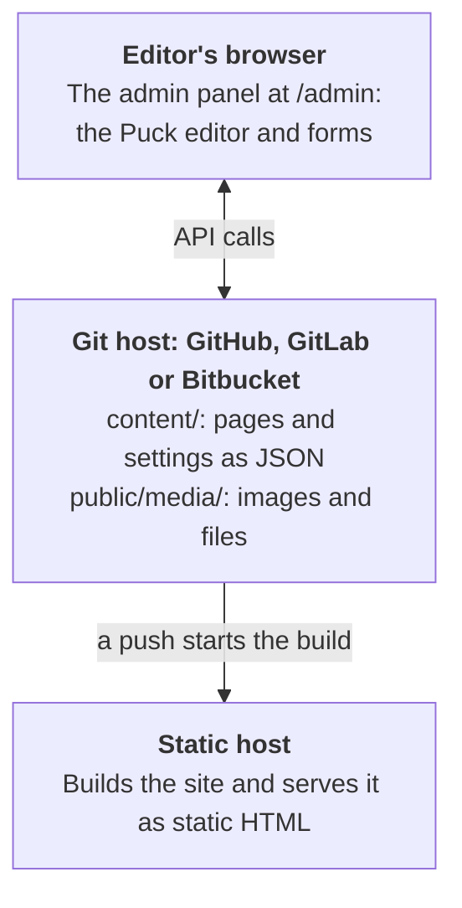

<h1>
  <picture>
    <source media="(prefers-color-scheme: dark)" srcset="docs/public/media/logo-dark.svg">
    
  </picture>
</h1>

**Goodfellow CMS** is a git-based website builder built on the [Puck](https://puckeditor.com) visual editor.

Goodfellow gives non-technical site owners a drag-and-drop editor at `/admin` with no server, database or monthly hosting bill. Pages are stored as files in the site's own GitHub, GitLab or Bitbucket repository. Every save is a commit, and a static host rebuilds the site: GitHub Pages, GitLab Pages, Cloudflare Pages and Vercel, whose free plans it has setup files for, or [any other](https://goodfellow-cms.github.io/goodfellow-cms/docs/any-host), such as AWS, Google Cloud or DigitalOcean. It started with small organizations run by volunteers, and is built to suit larger ones too, where a marketing team runs the content and developers own the code, its blocks and its reviews.

> **Status: early development.** The packages are on npm, released together with one version number, and the [open issues](https://github.com/goodfellow-cms/goodfellow-cms/issues) show what's planned. The [documentation](https://goodfellow-cms.github.io/goodfellow-cms/), built with Goodfellow, describes the latest release: what Goodfellow does, how to [create a site](https://goodfellow-cms.github.io/goodfellow-cms/docs/create-a-site), and how to write blocks. [The demo](https://goodfellow-cms.github.io/goodfellow-cms/demo/admin/) lets anyone try the admin panel.

## How it works

- **No server.** The admin panel is part of the static site and talks to the GitHub, GitLab or Bitbucket API straight from the browser. Next.js apps with a server of their own can have it [publish for editors](https://goodfellow-cms.github.io/goodfellow-cms/docs/full-stack-nextjs) instead.
- **Instant preview.** The editor renders pages in the browser, so editors see changes before anything is published.
- **Publishing is a commit.** A commit to the main branch triggers the host's normal build. The admin panel shows when the new version is live.
- **Content is plain files.** One JSON file per page, readable in any diff and portable to other tools.
- **Apps too.** Builds also write the content as [static JSON](https://goodfellow-cms.github.io/goodfellow-cms/docs/content-api), which an [Expo app](https://goodfellow-cms.github.io/goodfellow-cms/docs/apps) for iPhone and Android shows natively, offline too.

## Free, always

Goodfellow's core will always be free and open source. [Goodfellow Cloud](https://goodfellow-cms.github.io/goodfellow-cms/docs/goodfellow-cloud) is planned for the future, once enough organizations are interested: a hosted service that would set up and run the services site owners put online themselves today, such as Sign in with GitHub, the token broker, the Claude connector and media storage. Everything it would run stays free to set up yourself. To hear when it opens, [join the waitlist](https://goodfellow-cms.github.io/goodfellow-cms/cloud/).

## Sponsor Goodfellow

Goodfellow is free and open source. If it's useful to you, [become a sponsor](https://github.com/sponsors/goodfellow-cms) to help keep it going.

<!-- sponsors:start -->
<!-- sponsors:end -->

## Contributing

To report a problem or suggest a feature, [open an issue](https://github.com/goodfellow-cms/goodfellow-cms/issues/new/choose); for security problems, see [SECURITY.md](SECURITY.md). To contribute, see [CONTRIBUTING.md](CONTRIBUTING.md); [AGENTS.md](AGENTS.md) has the architecture rules and conventions. They apply to human contributors as well as coding agents. [RELEASING.md](RELEASING.md) explains how versions are released to npm.

## License

[MIT](LICENSE)

## Acknowledgements

Goodfellow is built on [Puck](https://github.com/puckeditor/puck) and is not affiliated with Puck or its maintainers. The name comes from Robin Goodfellow, the other name of Puck in *A Midsummer Night's Dream*. Sign-in and backend design draw on [Sveltia CMS](https://github.com/sveltia/sveltia-cms) and [Decap CMS](https://decapcms.org).
