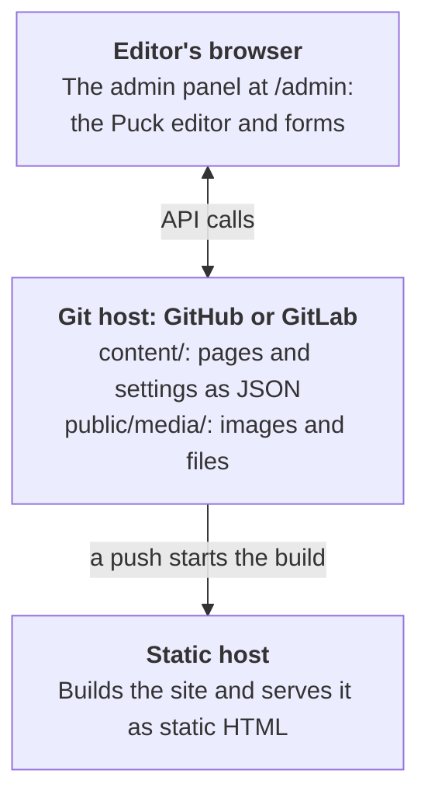

<h1>
  <picture>
    <source media="(prefers-color-scheme: dark)" srcset="docs/public/media/logo-dark.svg">
    
  </picture>
</h1>

A git-based website builder built on the [Puck](https://puckeditor.com) visual editor.

Goodfellow gives non-technical site owners a drag-and-drop editor at `/admin` with no server, database or monthly hosting bill. Pages are stored as files in the site's own GitHub or GitLab repository. Every save is a commit, and a free static host (GitHub Pages, GitLab Pages or Vercel) rebuilds the site.

> **Status: early development.** The packages are on npm, released together with one version number, and the [roadmap](#roadmap) shows what's done and what's next. The [documentation](https://goodfellow-cms.github.io/goodfellow-cms/), built with Goodfellow, describes the latest release: what Goodfellow does, how to [create a site](https://goodfellow-cms.github.io/goodfellow-cms/docs/create-a-site), and how to write blocks. [The demo](https://goodfellow-cms.github.io/goodfellow-demo/admin/) lets anyone try the admin panel.

## How it works

- **No server.** The admin panel is part of the static site and talks to the GitHub or GitLab API straight from the browser. Next.js apps with a server of their own can have it [publish for editors](https://goodfellow-cms.github.io/goodfellow-cms/docs/full-stack-nextjs) instead.
- **Instant preview.** The editor renders pages in the browser, so editors see changes before anything is published.
- **Publishing is a commit.** A commit to the main branch triggers the host's normal build. The admin panel shows when the new version is live.
- **Content is plain files.** One JSON file per page, readable in any diff and portable to other tools.

## Roadmap

1. **Static rendering** (done). Build a static site from hand-written `content/` files.
2. **Editor** (done). The admin panel against local files: pages, site settings, header and footer, custom CSS, live Tailwind preview.
3. **Git backends** (done). GitHub and GitLab sign-in, publishing, conflict detection and deploy status, plus GitHub Pages, GitLab Pages and Vercel setups.
4. **Collections and templates** (done). Collections with their own fields, a shared page design for their items, and a block that lists them on other pages.
5. **AI assistant** (done). Draft and rewrite pages with Claude, OpenAI or a free AI service, called straight from the editor's browser with the editor's own key. Editors without a key can copy a prompt into Claude.ai or another chat app and paste the answer back.
6. **Media library** (done). Upload, browse and replace images and files from the admin panel, and choose them for blocks and settings. A Video block plays uploaded videos, YouTube and Vimeo videos, and other sites' players, without adding JavaScript to the site's pages.
7. **Starters** (done). `create-goodfellow`, which creates a site and sets up its storage and host, and an example parish site with collections and custom blocks.
8. **Next.js adapter** (done). Goodfellow pages and the admin panel in a Next.js app, exported as static files, with a Next.js starter. Links use `next/link` and images `next/image`, sites can be served from a subfolder, and blocks can use Client Components.
9. **Interactive blocks everywhere** (done). Client Components in blocks (`"use client"`) run in the browser on sites built with `goodfellow build` too, not only with Next.js.
10. **shadcn blocks** (done). A registry of Goodfellow blocks built with [shadcn/ui](https://ui.shadcn.com), installed into the site without a developer. When creating a site, admins choose "Recommended" or "Built-in blocks only"; the admin panel lets them add and remove individual blocks. Others can publish registries of blocks built with other libraries, in a documented format. Updating installed blocks comes with step 16's automatic updates.
11. **Demo mode** (done). A site whose config sets `demo: true` (it can only be turned on in the config, never from the admin panel) opens its admin panel to anyone, with no sign-in. Visitors can try everything, from editing pages and collections to the media library, settings and the AI assistant, but nothing is published: their changes stay in their own browser until they start over. The demo starts from a copy of the site's content that the build includes, so the repository can stay private.
12. **Documentation site** (done). A documentation site built with Goodfellow itself, in `docs/`, and the blocks it needs, which any site can use: code with syntax highlighting, search (with [Pagefind](https://pagefind.app), indexed only on sites that use a search block), navigation within a collection, previous and next links, and an "On this page" list. Collections can store their items as Markdown files, edited in the admin panel's formatted editor or as Markdown. The docs cover why Goodfellow exists and how it compares with alternatives such as WordPress and TinaCMS, guides for site owners and editors, reference docs for developers, and each host's rules for business sites on its free plan. Online at [goodfellow-cms.github.io/goodfellow-cms](https://goodfellow-cms.github.io/goodfellow-cms/) since step 13.
13. **Going live** (done). Make the repository public, publish the packages to npm, and put the documentation site online with GitHub Pages. A demo site, made from the parish example in a repository of its own with the published packages, goes online with GitHub Pages too, and the docs link to it.
14. **Site setup without a developer** (done). The documentation site's [Create a site](https://goodfellow-cms.github.io/goodfellow-cms/new-site/) page creates a site from any starter, with the same choices as `create-goodfellow`, in the person's own GitHub or GitLab account, straight from their browser, and puts it online with GitHub Pages, GitLab Pages or Vercel. It asks what the site is for and recommends a host whose free plan allows it, such as GitLab Pages for a business, and warns that GitHub Pages doesn't work with private repositories on GitHub's free plan. On GitHub, people sign in with a token the page links to, or with GitHub where the page has step 21's sign-in service; on GitLab, with GitLab or a token. The page writes the repository into the site's config, so nobody has to edit it.
15. **Custom domains** (done). Connect a domain from the admin panel's **Site Settings → Domain**. Goodfellow connects it on GitHub Pages or GitLab Pages, lists the records to add at the domain's registrar, with guides for popular registrars in the docs, and checks until the domain works: the records, as the world sees them, the host's HTTPS certificate, and the site at its new address. Then it sends everyone to the secure address. Sites on Vercel connect their domain in Vercel, as the screen explains.
16. **Running a site without a developer.**
    - Invite and remove editors from the admin panel (done).
    - Version history, with a way to restore an earlier version of a page (done).
    - Automatic updates (done): a scheduled job updates Goodfellow, and blocks added from block registries, and publishes the update only if the site still builds. Block updates replace only files nobody has changed. Fixes install on their own; newer releases when an owner chooses them. Owners can turn automatic fixes off, or go back to the previous release, which is then skipped.
    - Plain-language explanations when a rebuild fails (done).
    - Redirects from old addresses, set up in Site Settings and added when a page moves, which work on every host (done).
17. **Calendars** (done). An Events collection and a Calendar block, worked out when the site builds, so visitors only get HTML.
    - **Events** have a start and end date and time, an all-day option, a place, and repeats (daily, weekly, monthly or yearly, every so often, on chosen weekdays or the same weekday of the month, until a date, with dates to skip), so a weekly service is one entry. Collections get a date-and-time field for them, which any collection can be a calendar of, and Site Settings a time zone. New collections can start as Events.
    - **The Calendar block** shows upcoming events as a list or a month at a time, with a page for each month. The nightly rebuilds keep "upcoming" current.
    - **Calendars kept elsewhere:** the block can also show a public calendar feed (an `.ics` address, such as Google Calendar's), read when the site builds, so editors who keep a Google Calendar go on doing so and the site catches up on its next build.
    - **Subscribing:** the build writes the events as an `.ics` file that visitors can subscribe to, and each event has "Add to calendar" links.
    - **The docs** also describe embedding a Google Calendar in a Custom HTML block (with its sanitizing turned off, since that removes embedded frames), following Google's guide, [Add a calendar to your website](https://support.google.com/calendar/answer/41207). The calendar is then managed in Google, and changes show up at once rather than after the next rebuild, though it looks like Google's calendar rather than the site.
18. **Showing collections** (done). Blocks that show a collection's items anywhere on the site, such as a blog page with every post or a home page section with the three latest news articles or the next five events, worked out when the site builds, so visitors only get HTML.
    - **Collection list** filters by a choice field or by tags (a new field type for several choices), has a heading and a "See all" link, and more ways to sort.
    - **Pages of items:** a long list is split into pages of its own (`/blog/page/2`), with links between them, and a list can have a page for each of a field's choices (`/blog/topics/events`). Any block can ask for pages like these, as the Calendar block does for its months. Each page has its own address for search engines, and only the first is in the site's own search.
    - **Collection loop:** a block whose contents, designed in the editor with any blocks, repeat once for each item, with the item's fields filled in as in a collection's page design, for layouts the list's own styles don't cover.
    - Visitors don't sort or filter lists themselves: editors choose each list's order and filters, and the Search block finds the rest.
19. **Forms** (done). A Form block whose questions (wording, kind of answer, whether it must be answered, choices and help text) are set in the editor.
    - **No server:** it's a plain HTML form that posts to a form service and works without JavaScript; the service emails the answers and sends visitors back to a thank-you page the editor chooses. The service is chosen once in Site Settings: [Web3Forms](https://web3forms.com) by default (250 answers a month free, and no account, just an email address), [Formspree](https://formspree.io) (whose free plan shows its own thank-you page), or any service that accepts a plain form post.
    - **Spam:** a hidden honeypot field on every form, plus the service's own captcha: Formspree's reCAPTCHA, or Web3Forms' hCaptcha, which a Site setting turns on, since it needs Web3Forms' script on pages with a form.
    - **Longer forms**, such as surveys and sign-up sheets, can use Google Forms: the Form block shows one from its embed code.
    - **The docs** explain that answers go to the chosen service, not to the site's repository.
20. **Stock photos from the AI assistant** (done). When the media library has nothing that fits, the AI assistant can add openly licensed photos from [Openverse](https://openverse.org), which gathers Creative Commons and public domain images from Wikimedia Commons, Flickr and other collections. It's searched straight from the editor's browser with no key, and only photos whose license allows commercial use and changes are offered. Each photo is saved to the media library with its credit, which the site shows as the license requires. A checkbox in the AI panel turns this on or off for each request and is remembered in the browser; a site's config can turn it off for everyone. (Not Unsplash: its API needs a key that a browser can't keep secret, and its rules require showing photos from Unsplash's own addresses rather than the site's media library.)
21. **Sign in with GitHub** (done). A small Cloudflare Worker that a site's owner, or an organization for all its sites, can run, so editors sign in with GitHub instead of pasting a token. Goodfellow may run one for every site in the future; until then, sites without one sign in with tokens. GitLab sign-in already works without one.
    - **Narrow tokens:** site owners install a Goodfellow GitHub App on the repositories they choose, which the first sign-in offers, and GitHub's install page signs them in too. The worker gives the admin panel a token for one repository only, with only the permissions it needs (not workflows or repository settings), lasting an hour and renewed while the editor is signed in. It stores nothing: the editor's own GitHub token is revoked as soon as they've signed in, and commits still show the editor as their author.
    - **Only to the site's own address:** the worker hands a token only to an address the repository's site settings list, never to `localhost`, since `goodfellow dev` and `next dev` don't need one.
    - **Within Cloudflare's free plan:** the worker keeps no counts of its own, since every request it gets counts towards the plan's daily limit, even one it turns away. When the day's requests run out, editors sign in with a token until the next day, and a Cloudflare rate limiting rule, on a domain of its own, can stop any one computer using them up.
    - **Token sign-in stays:** when the admin panel can't use the worker, for example because its limit for the day has been reached or a production build is being viewed on `localhost`, editors sign in with a token as they do now.
    - **Protected history:** the site setup page (step 14) can sign in through the worker too, and gives new repositories rules that stop anyone rewriting the main branch's history, where the GitHub plan allows it. GitLab protects it by default.
    - **Owner tools:** a second Goodfellow GitHub App, with the Administration and Pages permissions, used only by owners on the Editors and Domain screens, replaces the owner token. The everyday sign-in's app never gets those permissions, so editors' tokens can't delete the repository or change its settings.
    - **Setting it up:** `pnpm run setup` deploys the worker and creates its two GitHub Apps, and the site's config names its address.
22. **Claude connector** (done). An MCP server, so editors can work on their sites from Claude: read pages, items and settings, see the site's blocks, make changes in a draft, check them in screenshots, and publish them or submit them for review.
    - **Ways to use it:** a Claude Desktop extension (a `.mcpb` file) and `claude mcp add` for Claude Code, running on the editor's computer with a token; or a connector service on Cloudflare Workers, which an organization runs with `pnpm run setup`, as for the sign-in service, and editors add as a custom connector in Claude on the web, on computers and on phones, and in Claude Code. Goodfellow may run one for everyone in the future.
    - **Drafts:** changes go into a draft, a branch of the site's repository, and publishing applies it to the main branch in one commit, stopping rather than overwriting anyone else's changes. Submitting for review opens a pull request or merge request.
    - **Versions:** each site's build publishes a description of its blocks and of the content formats it reads (`goodfellow-site.json`), so Claude writes only content that site understands. It works with the current and previous minor versions of Goodfellow, and asks older sites to update.
    - **Nothing stored:** the connector signs in to GitHub through its own GitHub App, separate from step 21's, and gets a token for one repository for each of Claude's requests, which it revokes once the request is answered. Who connected and which sites they chose are sealed inside Claude's own tokens; the only thing stored is a number for each connection, so a refresh token works once. GitLab, which has no tokens for one project, uses the editor's own GitLab sign-in, sealed the same way.
    - **Within Cloudflare's free plan:** the tools read only the files they need, in batches, to fit the free plan's limits on each request, and Cloudflare's own limits and rate limiting rules apply, as for the sign-in service.
    - **Screenshots** of the live site, and of drafts through a preview page in each site's admin panel, taken with Cloudflare's Browser Rendering, or with the editor's own Chrome or Edge on their computer.
23. **Light and dark sites** (done). A site can have a dark mode, which its owner turns on in Site Settings: sites are light only until then. Every theme color has a dark one, and pages follow the visitor's light or dark setting. Blocks follow the theme in both, a site can have a second logo for dark backgrounds, code changes to dark colors with the page, in code colors the site chooses, visitors can choose light or dark with the Dark mode switch block, and the admin panel's previews show either.
24. **Full-stack Next.js sites** (done). For organizations with a developer: Goodfellow as the CMS of a Next.js app with a server of its own, beside the app's own pages. Sites without a server stay the default, and nothing here becomes required for them.
    - **Sign-in through the app:** the admin panel signs in with the app's own authentication (such as Better Auth), and the app says who may edit and publish, and who may also change settings.
    - **Git on the server:** the app's server reads and publishes through GitHub or GitLab with a token from an environment variable, behind that sign-in, so no git credentials reach the browser. Commits still name the editor.
    - **AI keys on the server** (optional): keys in environment variables, with the AI assistant's requests sent through the app's server, so editors don't need keys of their own.
25. **Content in a repository of its own** (done). A site can keep its content (`content/` and `public/media/`) in one repository and its code in another, so the tokens editors and full-stack sites' servers use can change the content but never the code that builds and runs the site.
    - **Either repository builds:** the content repository's build checks out the code without being able to change it (with a deploy key on GitHub, or the job token on GitLab) and publishes the site, so the admin panel still shows when a change is live, explains failed rebuilds and connects domains; or the code repository builds, and a change to the content starts it through the host's deploy hook. Whoever can push to the repository a host builds from controls the build, so sites whose build holds secrets, such as a full-stack site's token and keys, build from the code repository. Nightly updates run in the code repository, which then starts the build.
    - **Setup:** `create-goodfellow` and the setup page offer it, with either repository building, and create both repositories and what connects them.
    - **In the admin panel**, everything that edits content works as before. Adding and removing blocks writes code, so it becomes a developer's task, and the Updates screen follows the code repository's updates.
    - **Settings stay with the content:** Site Settings, custom CSS and code, and collections' settings stay in the content repository, since some saves change settings and content in one commit, such as removing a collection's field from every item.
    - **Developers** keep a copy of the content repository beside the code, which `goodfellow dev` and `next dev` read and save to.
26. **Site checks** (done). Catch mistakes before they're published, in the admin panel when publishing and in builds.
    - **Errors that stop publishing:** links to pages, items or media that don't exist, including ones a deletion would break, besides the checks loading the site already makes. Moving a page or an item, or changing a collection's addresses, updates every link to them instead.
    - **Warnings editors can publish anyway:** pages without a title or description, theme colors that text is hard to read on (which the Theme tab shows as colors are chosen), and, on the pages a publish changes as they'll show, images without alt text, headings that skip a level, and links whose text doesn't say where they go ("click here").
    - **In builds:** `goodfellow build` lists what the checks find, and `--strict` fails the build on errors. Built pages, Next.js sites' too, are also checked for accessibility problems with axe-core, explained in plain words. Automated checks can't show that a site is fully accessible, so Goodfellow never claims it is.
27. **Scheduled publishing** (done). Pages and collection items that appear at a date and time, and disappear after one, such as a bulletin, a Lent schedule or a closure notice.
    - Content carries its own "show from" and "hide after", which builds apply in the site's time zone, as calendars do. On GitLab, the admin panel adds a pipeline schedule for each time, so changes go live then; on GitHub, the starters check each hour and build the site only when something is due, so changes go live within the hour.
    - The admin panel lists what's coming up, and when.
    - Scheduled content is in the site's repository before it appears, so on a public repository anyone can read it there early, as the admin panel says when scheduling.
    - Later, a group of changes can be scheduled together, as a draft that's published at a set time.
28. **Search engines and feeds** (done).
    - **Structured data** (schema.org JSON-LD), so search engines show events with their dates and places, and news as articles.
    - **For each page:** hiding it from search engines, and a preview of how it looks when shared.
    - **Feeds:** RSS and Atom feeds of collections whose items are dated, such as news, which feed readers and other sites can follow.
29. **Moving from and to WordPress** (done).
    - **Importing:** a WordPress site's pages, posts, categories, tags, menus and media, from its export file or its address, in the admin panel or from the command line, with WordPress's blocks turned into Goodfellow's and old addresses kept or redirected.
    - **Exporting:** a Goodfellow site as a WordPress export file, in the admin panel or from the command line, with its blocks turned into WordPress's.
30. **Restoring the whole site** (done). Version history beyond one file: owners can see how the whole site, its content and settings, looked at an earlier publish and what has changed since, and restore it as one publish, for example after a bulk change that went wrong.
31. **Several languages.** Optional, for sites in more than one language, such as a parish with Masses in two.
    - Translations of a page or collection item linked together, each with its own address, menu, title and description, and dates written the language's way.
    - A language switch, `hreflang` links, and sitemaps that list each language.
    - Which translations are missing or out of date, and what visitors see where one is missing.
32. **Cloudflare Pages.** Put sites online with [Cloudflare Pages](https://pages.cloudflare.com), whose free plan builds from private repositories on GitHub and GitLab and has no rule we've found against business sites. That makes it the free choice for a business site whose repository is private on GitHub, where GitHub Pages doesn't work.
    - **Setup:** `create-goodfellow` and the setup page set it up, the admin panel shows when the new version is live, and the Domain screen explains connecting a domain in Cloudflare, as it does for Vercel.
    - **Pages or Workers:** Cloudflare's newer features go to Workers, which can also serve a site's files and build it from GitHub or GitLab, and it has a guide for moving Pages projects there. This step starts by choosing between them.
    - **Redirects:** Cloudflare sends redirects itself from a `_redirects` file in the site's build output, which Pages and Workers both read. `goodfellow build` and `goodfellow-next finish` write it next to the redirect pages, which stay for other hosts. Cloudflare follows a redirect even where the site has a file, so the build leaves out redirects from every address its output has, including pages that blocks add. Cloudflare reads up to 2,000 fixed redirects, about 1,000 old addresses at two lines each; past that, the build warns, and the redirect pages handle the rest.
    - **Videos:** Cloudflare's terms ask sites on free plans not to serve video, or mostly large files, through its network without a paid service. The admin panel says so where uploaded videos would break that rule, and suggests YouTube or Vimeo.
33. **Keeping tokens away from third-party code.** So owners can install plugins safely (step 34), editors' tokens and builds' secrets can be kept away from any code Goodfellow didn't write.
    - **A token broker, if the site's owner wants one:** a small static page on an address of its own, which keeps editors' GitHub and GitLab tokens and AI keys in its own storage and makes every call to the git host and AI services itself. It shows the site's admin panel in a sandboxed frame, which asks it to read files and publish changes through messages, so nothing on the admin panel's or the site's own address can read the tokens, Goodfellow's own code included. It answers only the site whose address the repository's settings list, never changes workflow files, and asks the editor, in its own part of the page outside the admin panel's frame, before publishing code, packages or custom code. Signing in gives tokens to it rather than to the site. Sites without one keep signing in as they do now, with the admin panel keeping its own tokens where the editor chose.
    - **Run by the site's owner:** a site, or an organization for all its sites, serves the broker's files from an address of its own that hosts nothing else, deployed from a release. Goodfellow may run one for everyone in the future, deployed only from releases and with no preview copies, so it's always a released version.
    - **Adding one to an existing site:** Site Settings' Security tab offers owners **Add a token broker**. With the owner's sign-in, it creates the broker's repository from Goodfellow's released files and puts it online, then publishes its address in the site's config, so editors sign in through it once the site has rebuilt. The address has to be the broker's alone: Cloudflare Pages and Vercel give it one, and so do GitHub Pages and GitLab Pages with a domain of its own, or GitLab Pages with its unique domain setting on. Never a shared `github.io` or `gitlab.io` address, such as `your-name.github.io/broker` or `your-group.gitlab.io/broker`, which every Pages site in the same account or group shares. `goodfellow broker add` does the same from a computer, `create-goodfellow` and the setup page offer one for new sites, and removing the broker goes back to the admin panel keeping its own tokens.
    - **An admin domain, instead of or as well as a broker:** the same build at a second address, such as `admin.example.com`, where editors sign in, while visitors use `example.com`. It's another origin, so the site's pages can't read the admin panel's storage, and it needs no second repository. It needs:
      - **The admin domain to be only the admin panel's:** every other page there gets `Content-Security-Policy: sandbox`, which runs it in an opaque origin without the admin panel's storage, so a page served there can't read tokens even when a site page frames it. Tried first in Chromium: a pasted script on a site page served from the admin domain read the token without the header and was refused with it. Cloudflare Pages does this with a `_headers` rule for the admin domain and `! Content-Security-Policy` under `/admin/*`; Vercel with `headers` that match the host, or `redirects` that send those pages to the site.
      - **The admin panel to start only at its own address,** named in `goodfellow.config.tsx`, not content, since sign-in gives tokens to it; elsewhere, such as `example.com/admin/`, it sends people there.
      - **Headers on the admin panel:** `Cross-Origin-Opener-Policy: same-origin`, `frame-ancestors 'none'`, and `Origin-Agent-Cluster: ?1`, since the two addresses are the same site though they're different origins.
      - **Setting it up:** the Domain screen connects the second domain and writes the host's rules, and the admin panel counts it only once it has checked them, by loading a site page from its own address and finding it sandboxed or redirected.
      - **Where it works:** Vercel, and Cloudflare Pages once sites can use it (step 32). Not GitHub Pages, which has one domain for each site, or GitLab Pages, which serves a page's file rather than a redirect that matches it and has no custom headers on GitLab.com; sites there use a broker.
    - **Without a broker or an admin domain, nothing third-party is installed from the admin panel:** the tokens there are within reach of the site's own pages, so the Blocks screen offers only Goodfellow's own registry, and plugins (step 34) can't be installed there. Developers can still add either in code. Themes can be installed on any site, since a theme is only CSS and JSON files, which the admin panel checks before writing them; a theme with any other file is refused.
    - **The editor in a sandbox of its own,** with or without a broker: Puck, the site's config and every block run in a frame sandboxed without `allow-same-origin`, whose code can reach nothing. It has no storage, can't open windows or reach the admin panel's page, and its Content Security Policy allows no requests and only the editor's own scripts. Every one of those scripts starts by removing WebRTC, which a Content Security Policy can't block. It talks to the admin panel through one message port, and the admin panel draws Publish outside it, so nothing in the editor can publish on its own.
      - **Previews:** Puck draws blocks straight into the editor's page (`iframe: { enabled: false }`), since a sandboxed page can't reach frames of its own. The editor's copy of the site's CSS is scoped to the canvas with `@scope`, so it can't restyle Puck, and its width media queries become container queries, so Goodfellow's own buttons preview pages at phone and tablet widths by resizing the canvas.
      - **The rest of the admin panel** keeps out of reach the same way: the Settings and Version history previews are the same kind of frame, and the AI panel moves out of the editor into the admin panel, with the keys in the broker where there is one.
      - **Tried first:** Puck 0.23 edited, dragged blocks and published this way in Chromium, the starter's CSS stayed on the canvas, and a block's requests, storage and WebRTC were all refused. Firefox and Safari need the same checks before it ships.
    - **What a broker or an admin domain closes:** the admin panel shares its address with the site it edits, and on `github.io` and `gitlab.io` addresses with every other site in the same account or group, so without either, scripts on those pages could read a token kept with "Stay signed in".
    - **Pages that open the admin panel can't reach it:** the broker sends `Cross-Origin-Opener-Policy: same-origin` and `frame-ancestors 'none'`, the admin panel opens links with `noopener`, and its own Content Security Policy keeps its frames on the editor's pages. The site's other pages get no Content Security Policy, so code admins paste in, such as analytics, keeps working without a list of the addresses it uses: those pages hold no tokens to protect.
    - **Safer builds:** the starters' builds hold no secrets and can't publish. The job that builds the site can only read the repository, the job that puts it online doesn't run the site's code, packages' install scripts run only where they're allowed, and the nightly update builds the site before a separate job publishes the update.
    - **Full-stack sites don't use the broker:** their admin panel signs in with the app's own sign-in and their server holds the token (step 24), so it would add nothing. The editor's sandbox still keeps blocks' code away from the app's API. Securing the rest, the app's server, sign-in, pages and secrets, is their developers' responsibility.
    - **A Security page in the docs** says what keeps a Goodfellow site safe, in general terms for owners and editors and in detail for developers: what each protection guards against and where it stops, and what a token broker or an admin domain adds. It says which protections don't cover full-stack sites, and that securing those is their developers' responsibility. It links to the pages that go further, such as running your own sign-in service and broker, Content in a repository of its own and Full-stack Next.js sites, and to how to report a security problem privately. Why Goodfellow links to it.
34. **Plugins and themes.**
    - **Plugins** add what blocks can't: where media is stored, screens in the admin panel, steps in the build, and routes on full-stack sites' servers. Anyone can publish one in a documented format, as with block registries, listed with its publisher's npm provenance and installed at an exact version.
    - **Each in a repository of its own,** Goodfellow's own included, so plugins are released on their own schedules and under their own licenses, and declare the Goodfellow versions they work with (a `peerDependencies` range on `@goodfellow-cms/core`), which the admin panel checks before installing one or updating Goodfellow. None live in this repository.
    - **Named so they're easy to find,** as NodeBB's are: repositories and npm packages are called `goodfellow-plugin-<name>` and `goodfellow-theme-<name>`, or `@scope/goodfellow-plugin-<name>` on npm, and carry the `goodfellow-plugin` or `goodfellow-theme` topic on GitHub and GitLab and keyword on npm, so searching any of them finds them. The admin panel lists only packages named this way. Block registries follow the same convention, which they already can: their repositories are called `goodfellow-blocks-<name>`, with the `goodfellow-blocks` topic.
    - **Permissions that are enforced where they can be:** a plugin declares what it needs, and each part runs where Goodfellow can hold it to that.
      - **Blocks in the editor** run in step 33's sandboxed editor, where they can do nothing on their own.
      - **What a plugin needs in the admin panel**, such as requests to its own service, runs in a sandboxed frame for that plugin, whose Content Security Policy the admin panel writes from its declared permissions, so it reaches only the addresses it declared. Its blocks ask it by message, and other plugins' code in the editor could ask it too, but only for what it offers, never its access itself.
      - **Screens in the admin panel** run in frames of their own the same way, which the admin panel answers only for what the plugin declared, such as reading media or writing `content/media.json`. The token broker (step 33) refuses publishes outside the files it declared.
      - **Build steps** each run in a process of their own, with only the secrets they declared and Node's permission model limiting which files they read and write, in a job that can't publish.
      - **What can't be enforced is said plainly:** code on the site's pages runs with everything visitors' browsers allow, since pages have no Content Security Policy (step 33), and a plugin's code runs with everything its process has, with the packages it brings sharing it. So the admin panel calls declared permissions what they are wherever only a review can back them.
    - **Installed by owners** from the admin panel, on sites with a token broker or an admin domain (step 33), which shows what each plugin asks to do and what its packages' code does (network requests, shell commands, `eval`, install scripts), with the editor confirming in the token broker, or with an admin domain, in the admin panel outside the editor's sandbox. New releases are installed only once they're a few days old, since most harmful releases are found by then. The site's own workflow then writes the lockfile with `npm install --package-lock-only --ignore-scripts`, which runs none of the new code, and the site rebuilds with it. Like blocks, plugins are only ever included when the site builds. On full-stack sites, whose builds and servers hold the server's secrets, installing one is submitted for review, for a developer to accept. Developers can still add them in code, on any site, and `create-goodfellow` and the setup page for new sites.
    - **S3 storage**, the first plugin (`goodfellow-plugin-s3`): media in any S3-compatible service (Amazon S3, Cloudflare R2, Backblaze B2, DigitalOcean Spaces, MinIO and others) in place of `public/media/`, with much larger files allowed, such as long videos, since nothing goes into the repository's history. Content still refers to media as `/media/…`, so pages don't change when a site's media moves, and turning the plugin on moves the site's existing media to the bucket.
      - **Static sites:** the access keys stay in GitHub's or GitLab's CI secrets, never in the admin panel or the browser. Uploads go through the site's CI, which holds the keys, so they take about a minute.
      - **Full-stack sites** can do the same, or keep the keys on their server, which signs uploads straight away.
    - **Themes:** a site's look as data, with no code, so owners can install one without anyone else's code running: its colors, fonts and other design tokens, the classes it gives blocks' named parts, optional CSS, and optionally a header and footer design. Published, named (`goodfellow-theme-<name>`) and listed like plugins, each in a repository of its own.
      - **Named parts:** every block marks its parts with stable names, such as `gf-code` or `gf-card-title`, which are part of Goodfellow's documented format and never renamed, like blocks' props. A theme gives each part classes, which come after the block's own and before what an editor types, so `my-6 rounded-lg` in a block, `my-4 rounded-xl` from the theme and `my-8 mx-4` from an editor give `rounded-xl my-8 mx-4`. Blocks from registries can name their parts too.
      - **Installing**, on any site, copies the theme's CSS and JSON files into the site's content, where owners change it like any setting, with a record of where it came from, so an update to the theme keeps what they changed. Where its CSS loads anything but Google Fonts and the site's own media, the admin panel lists what before installing it.
35. **Bitbucket.** Sites stored on Bitbucket Cloud, as a third backend, `@goodfellow-cms/bitbucket`, with everything GitHub and GitLab have, or a capability flag the admin panel handles where Bitbucket can't do something.
    - **First, what works from a browser:** the step starts by checking that Bitbucket's API answers browsers' requests, how editors can sign in without a server (an access token always, and Bitbucket's own sign-in where it allows that), and that a publish of several files can be one commit that fails when someone else has published since.
    - **Putting sites online:** with Bitbucket Pipelines on Vercel, or Cloudflare Pages (step 32) if it builds from Bitbucket by then, since Bitbucket's own static websites have one address for each workspace and no custom domains. `create-goodfellow` and the setup page create sites there too.
    - **Same as the others:** version history, editors, drafts and reviews (pull requests), failed rebuilds explained, nightly updates and scheduled publishing through Pipelines' schedules, with a fake of Bitbucket's API for the tests, as GitHub and GitLab have.
36. **Gutenberg as an editor.** A plugin (step 34) that lets editors edit pages in WordPress's block editor, Gutenberg, in place of Puck, for people who already know it. **Licensing needs to be confirmed before it's built:** Gutenberg's packages are GPL-2.0-or-later and Goodfellow is MIT, so the plugin would be a GPL package in a repository of its own, `goodfellow-plugin-gutenberg`, as every plugin is, and what that means for a site's admin panel that includes it, and the site's own blocks built with it, needs checking with someone who knows licensing.
    - **Nothing changes outside the editor:** content stays in Goodfellow's files as it is, so the plugin can be added to or removed from any site, and each editor can choose Puck or Gutenberg for themselves.
    - **Any block:** each of the site's blocks becomes a Gutenberg block of its own, made from the site's config, with its props kept exactly as they are and its slots as Gutenberg's inner blocks, never written as HTML, so going back and forth loses nothing. A test round-trips every page of the starters, the example and the docs. Blocks with several slots need a way to place each one inside the block's own layout, which Gutenberg doesn't offer, so a prototype of one comes first.
    - **The rest of the editor:** blocks' fields as Gutenberg's settings, page settings in a sidebar of their own, Gutenberg's own styling options turned off since content has nowhere to keep them, pasted HTML turned into Goodfellow's blocks with the WordPress import's code, and the AI assistant, the media chooser and the link preview working as they do with Puck.
    - **In the plugin system:** step 34 gets a kind of plugin that replaces the page editor, run in a sandboxed frame like the editor in step 33, which hands back the page's data and never sees a token; the admin panel checks what comes back against the blocks' fields before publishing.

Planned for later: review workflows (pull/merge requests from the admin panel), per-user permissions and importing from other systems.

## Contributing

To report a problem or suggest a feature, [open an issue](https://github.com/goodfellow-cms/goodfellow-cms/issues/new/choose); for security problems, see [SECURITY.md](SECURITY.md). See [AGENTS.md](AGENTS.md) for architecture rules and conventions. They apply to human contributors as well as coding agents. [RELEASING.md](RELEASING.md) explains how versions are released to npm.

## License

[MIT](LICENSE)

## Acknowledgements

Goodfellow is built on [Puck](https://github.com/puckeditor/puck) and is not affiliated with Puck or its maintainers. The name comes from Robin Goodfellow, the other name of Puck in *A Midsummer Night's Dream*. Sign-in and backend design draw on [Sveltia CMS](https://github.com/sveltia/sveltia-cms) and [Decap CMS](https://decapcms.org).
